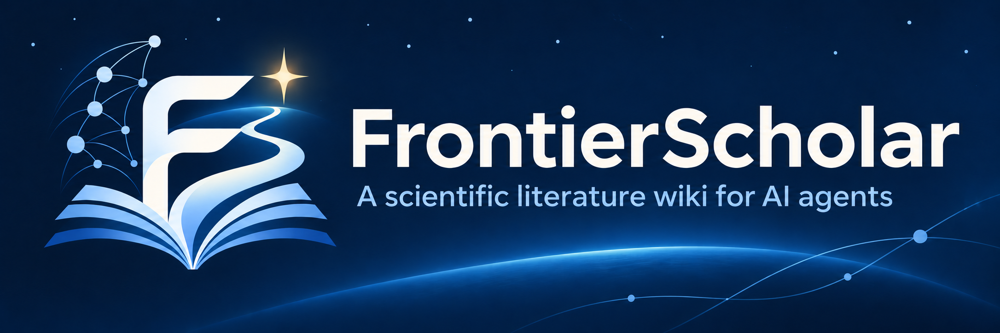

<p align="center"></p>

<h1 align="center">
  FrontierScholar · 知沿学术
  <br>
  <sub>🔬 A scientific literature wiki for AI agents 🤖</sub>
</h1>

<p align="center">
  <a href="https://frontier-scholar.com/"></a>
  <a href="#demo"></a>
  <a href="https://frontier-scholar.com/blog/introducing-frontierscholar-en/"></a>
  <a href="https://pypi.org/project/frontier-scholar/1.3.1/"></a>
  <a href="https://frontier-scholar.com/docs/"></a>
  <a href="LICENSE"></a>
  <a href="#citation"></a>
</p>

<p align="center">
  <b>English</b> · <a href="README.zh-CN.md">简体中文</a>
</p>

FrontierScholar is a research wiki of about 1.01M computer-science papers, built for coding agents to explore
the literature, follow emerging approaches, and identify open research problems. Papers are organised into
domains, topics and subtopics, with pages covering research problems, method families, datasets and benchmarks,
and a frontier page for each subtopic. Every claim links back to its source papers. This repository provides
the `fs` command-line client and the `fs-cli` agent skill.

## 🎬 Demo <a id="demo"></a>

Watch an agent explore recursive self-improvement in four steps: find the subtopic, browse its research pages,
read the frontier, and check the supporting paper's original abstract.

https://github.com/user-attachments/assets/1cad678f-595a-481d-867c-5d3d1c4307e6

## 🚀 Quick Start <a id="quick-start"></a>

### 1. Install the CLI

Requires Python 3.8+ with no additional Python dependencies. Install the `fs` command, then check the CLI and
API versions, data snapshot, and service connection:

```bash
pip install frontier-scholar
fs --version
```

`fs` connects to the public endpoint at `https://frontier-scholar.com`. No API key is needed to get started;
usage is limited per IP. For a higher quota, [contact us](#contact) for a key and set `FS_API_KEY`
(see [Access & Limits](#access-and-limits)).

### 2. Install the skill

The `fs-cli` skill teaches your coding agent when and how to search the wiki, read research pages, and check
the supporting papers. Install it with either command:

```bash
npx skills add FrontierScholar/FrontierScholar
# or with the GitHub CLI
gh skill install FrontierScholar/FrontierScholar
```

You can also copy [`skills/fs-cli/`](skills/fs-cli/) into your agent's skills folder. The skill works with
Claude Code, Codex, Cursor, Gemini CLI, pi, and other agents that support skills.

### 3. Ask in your coding agent

After installing the skill, open your coding agent, such as Claude Code, Codex, or pi, and ask in plain language:

**📚 Trace a field's development**

> Use fs to trace the development of retrieval-augmented generation (RAG), identify key milestones and method families, and cite representative papers.

**🏆 Find leading methods on a benchmark**

> Use fs to find the strongest reported methods on SWE-bench Verified in the indexed literature. Compare scores under comparable evaluation settings and cite the source papers.

**🧭 Explore research frontiers and open problems**

> Use fs to explore the research frontier of recursive self-improvement. Which approaches are rising, and what problems remain open? Cite the supporting papers.

**💡 Develop a research idea grounded in prior work**

> Use fs to review existing work on adaptive retrieval, then propose a research idea for improving retrieval quality under a fixed compute budget. Explain how it differs from prior work and suggest an experiment to test it.

## 🛠️ Commands <a id="commands"></a>

Use these commands directly in your terminal or let your agent call them through the skill.

| Command | What it does |
|---|---|
| `fs select "QUERY"` | The next level of the tree (domains, topics, subtopics), ranked by a query |
| `fs search paper "QUERY"` | Papers ranked by title, abstract and dataset names; `--before` / `--after` dates |
| `fs search wiki [index\|pages\|frontier\|bench] "QUERY"` | Subtopic overviews, problem / method / resource pages, frontier gaps and trends, benchmarks |
| `fs read TARGET...` | A paper (original abstract, date, subtopics), a paper's pages, wiki pages, folders, a subtopic's papers |
| `fs related ID...` | Papers the wiki groups with the given ones |
| `fs meta [wiki\|dates] ID...` | Titles and dates, subtopics, first-version date checks |

Results are JSON, except wiki pages, which print as Markdown. Queries retrieve existing content from a fixed
data snapshot using lookups and keyword (BM25) ranking; the API does not generate new content at query time.
Wiki pages summarise the papers, while paper records include the original abstracts.
Run `fs COMMAND -h` for all options and output fields, for example `fs search -h`.

From Python:

```python
from frontier_scholar import Client

r = Client().call("search/paper", {"query": "adaptive retrieval", "topk": 5})
for p in r["items"]:
    print(p["paper_id"], p["date"], p["title"])
```

The HTTP API is `POST https://frontier-scholar.com/api/v1/fs/<command>` with the arguments as JSON; see the
[documentation](https://frontier-scholar.com/docs/).

## ⏱️ Access & Limits <a id="access-and-limits"></a>

FrontierScholar is currently free to use without registration during an introductory period expected to last
approximately two weeks. You can install the CLI and start exploring immediately. Registration will open after
this period.

Without an API key, the public endpoint allows 30 requests per minute and 300 requests per day, per IP.
The maximum `--topk` value is 20; each `read` call accepts up to 5 targets, and each `meta` call accepts up to
50 IDs. The `--grep` option is unavailable without a key. To check your remaining quota, run:

```bash
curl https://frontier-scholar.com/api/v1/fs/quota
```

For a higher quota, [contact the FrontierScholar team](#contact) for a key and set it in the `FS_API_KEY`
environment variable, rather than in code. Requests then use your account's limits. For short-term rate limits,
`fs` waits and retries automatically; if the required wait exceeds 90 seconds, such as when the daily quota is
exhausted, it reports the error immediately. To use a different service endpoint, set `FS_BASE`.

## ✉️ Contact <a id="contact"></a>

Questions and suggestions are welcome in [GitHub Issues](https://github.com/FrontierScholar/FrontierScholar/issues).
You can also reach us by email:

- Angqing Jiang: [philipgaq@mail.ustc.edu.cn](mailto:philipgaq@mail.ustc.edu.cn)
- Jianlyu Chen: [chenjianlv@mail.ustc.edu.cn](mailto:chenjianlv@mail.ustc.edu.cn)
- Defu Lian: [liandefu@ustc.edu.cn](mailto:liandefu@ustc.edu.cn)

## 🙏 Acknowledgements <a id="acknowledgements"></a>

We thank the [DeepXiv](https://github.com/DeepXiv/deepxiv_sdk) team for DeepXiv-SDK, their open-source agentic data
interface for scientific literature.

## 📄 License <a id="license"></a>

Apache-2.0, see [LICENSE](LICENSE).

## 🔖 Citation <a id="citation"></a>

If you find FrontierScholar useful, please consider giving us a star ⭐ and citing it in your work:

```bibtex
@software{frontierscholar2026,
  title  = {{FrontierScholar}: A Scientific Literature Wiki for {AI} Agents},
  author = {{FrontierScholar Team}},
  year   = {2026},
  url    = {https://github.com/FrontierScholar/FrontierScholar}
}
```
