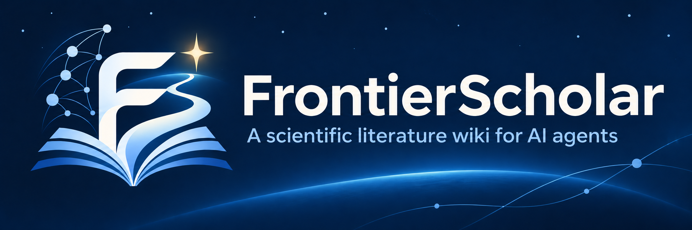

<p align="center"></p>

<h1 align="center">
  知沿学术 · FrontierScholar
  <br>
  <sub>🔬 A scientific literature wiki for AI agents 🤖</sub>
</h1>

<p align="center">
  <a href="https://frontier-scholar.com/"></a>
  <a href="#演示"></a>
  <a href="https://frontier-scholar.com/blog/introducing-frontierscholar/"></a>
  <a href="https://pypi.org/project/frontier-scholar/1.3.1/"></a>
  <a href="https://frontier-scholar.com/docs/"></a>
  <a href="LICENSE"></a>
  <a href="#引用"></a>
</p>

<p align="center">
  <a href="README.md">English</a> · <b>简体中文</b>
</p>

知沿学术是一个面向编程智能体的科研知识库，收录约 101 万篇计算机科学论文，帮助智能体检索文献、追踪新兴方法、
发现尚未解决的研究问题。论文按领域、主题和子主题组织，相关页面涵盖研究问题、方法类别、数据集与基准，
每个子主题还配有梳理研究前沿的页面。每一项论述都可追溯到对应的来源论文。
本仓库提供 `fs` 命令行客户端和 `fs-cli` 智能体技能。

## 🎬 演示 <a id="演示"></a>

观看智能体如何用四步探索递归自我改进的研究前沿：定位子主题、浏览研究页面、阅读前沿分析，再查看支撑论文的原始摘要，核对证据。

https://github.com/user-attachments/assets/abbea706-ee16-46d2-9371-acce5a32c8b2

## 🚀 快速开始 <a id="快速开始"></a>

### 1. 安装 CLI

需要 Python 3.8+，无额外 Python 依赖。安装 `fs` 命令后，检查 CLI 和 API 版本、数据快照及服务连接：

```bash
pip install frontier-scholar
fs --version
```

`fs` 默认连接公共服务 `https://frontier-scholar.com`，无需 API 密钥即可开始使用，额度按 IP 限制。
如需更高额度，可[联系我们](#联系方式)获取密钥并设置 `FS_API_KEY`（参见[使用说明](#使用说明)）。

### 2. 安装技能

`fs-cli` 技能告诉编程智能体何时以及如何检索知识库、阅读研究页面、核对支撑论文。以下两种安装方式任选其一：

```bash
npx skills add FrontierScholar/FrontierScholar
# 或使用 GitHub CLI
gh skill install FrontierScholar/FrontierScholar
```

也可以将 [`skills/fs-cli/`](skills/fs-cli/) 复制到智能体的技能目录中。
该技能可用于 Claude Code、Codex、Cursor、Gemini CLI、pi 等支持技能的智能体。

### 3. 在编程智能体中提问

安装技能后，打开 Claude Code、Codex 或 pi 等编程智能体，用自然语言提问：

**📚 调研一个领域的发展脉络**

> 用 fs 梳理检索增强生成（retrieval-augmented generation，RAG）的发展脉络，找出关键进展和主要方法类别，并引用代表性论文。

**🏆 检索 Benchmark 上的领先方法**

> 用 fs 检索知识库收录的文献中，在 SWE-bench Verified 上报告了最佳结果的方法。在可比的评测设置下比较分数，并引用来源论文。

**🧭 梳理研究前沿与开放问题**

> 用 fs 梳理递归自我改进（recursive self-improvement）的研究前沿：哪些方法正在兴起，还有哪些问题尚未解决？请引用支撑论文。

**💡 结合已有工作提出研究想法**

> 用 fs 调研自适应检索（adaptive retrieval）的已有工作，然后围绕“如何在固定计算预算下提升检索质量”提出一个研究想法。说明它与已有工作的区别，并设计一个验证实验。

## 🛠️ 命令 <a id="命令"></a>

以下命令既可在终端中直接使用，也可由智能体通过技能调用。

| 命令 | 功能 |
|---|---|
| `fs select "QUERY"` | 按查询相关性排序，返回知识树的下一层节点（领域、主题或子主题） |
| `fs search paper "QUERY"` | 根据标题、摘要和数据集名称对论文排序；支持 `--before` / `--after` 日期筛选 |
| `fs search wiki [index\|pages\|frontier\|bench] "QUERY"` | 搜索子主题概览、问题 / 方法 / 资源页面、前沿研究空白与趋势，以及基准 |
| `fs read TARGET...` | 读取论文（原始摘要、日期、子主题）、论文关联页面、知识库页面、目录或子主题下的论文 |
| `fs related ID...` | 查找知识库中与指定论文归为同组的论文 |
| `fs meta [wiki\|dates] ID...` | 查看标题、日期、子主题，并检查论文首个版本的日期 |

结果以 JSON 返回，知识库页面则以 Markdown 输出。查询通过查找和关键词（BM25）排序，从固定数据快照中检索已有内容，
API 不会在查询时生成新内容。知识库页面是根据论文撰写的总结，论文记录则包含原始摘要。
运行 `fs COMMAND -h` 可查看各命令的全部选项和输出字段，例如 `fs search -h`。

在 Python 中使用：

```python
from frontier_scholar import Client

r = Client().call("search/paper", {"query": "adaptive retrieval", "topk": 5})
for p in r["items"]:
    print(p["paper_id"], p["date"], p["title"])
```

HTTP API 为 `POST https://frontier-scholar.com/api/v1/fs/<command>`，参数以 JSON 形式传入，详见
[API 文档](https://frontier-scholar.com/docs/)。

## ⏱️ 使用说明 <a id="使用说明"></a>

FrontierScholar 目前限时开放免注册免费使用，体验期预计持续约两周。安装 CLI 后即可开始探索知识库，
体验期结束后将开放注册。

未配置 API 密钥时，公共服务按 IP 限制使用额度：每分钟最多请求 30 次、每天最多 300 次。
`--topk` 的最大值为 20，单次 `read` 最多接受 5 个目标，单次 `meta` 最多接受 50 个 ID，
且不支持 `--grep`。可通过以下命令查看剩余额度：

```bash
curl https://frontier-scholar.com/api/v1/fs/quota
```

如需更高额度，可[联系知沿学术团队](#联系方式)获取密钥，并将其设为环境变量 `FS_API_KEY`，不要写入代码。
之后的请求会使用该账户的额度。遇到短时限流，`fs` 会自动等待并重试；如果需要等待超过 90 秒，
例如当日额度耗尽，则会立即报告错误。可通过 `FS_BASE` 指定其他服务地址。

## ✉️ 联系方式 <a id="联系方式"></a>

如有任何问题或建议，欢迎在 [GitHub Issues](https://github.com/FrontierScholar/FrontierScholar/issues) 中反馈，
也可以通过邮件与我们沟通：

- Angqing Jiang：[philipgaq@mail.ustc.edu.cn](mailto:philipgaq@mail.ustc.edu.cn)
- Jianlyu Chen：[chenjianlv@mail.ustc.edu.cn](mailto:chenjianlv@mail.ustc.edu.cn)
- Defu Lian：[liandefu@ustc.edu.cn](mailto:liandefu@ustc.edu.cn)

## 🙏 致谢 <a id="致谢"></a>

感谢 [DeepXiv](https://github.com/DeepXiv/deepxiv_sdk) 团队提供 DeepXiv-SDK，这是一个面向智能体的开源科研文献数据接口。

## 📄 许可证 <a id="许可证"></a>

本项目采用 Apache-2.0 许可证，详见 [LICENSE](LICENSE)。

## 🔖 引用 <a id="引用"></a>

如果 FrontierScholar 对你有所帮助，欢迎为本仓库点亮 Star ⭐，并在你的工作中引用：

```bibtex
@software{frontierscholar2026,
  title  = {{FrontierScholar}: A Scientific Literature Wiki for {AI} Agents},
  author = {{FrontierScholar Team}},
  year   = {2026},
  url    = {https://github.com/FrontierScholar/FrontierScholar}
}
```
